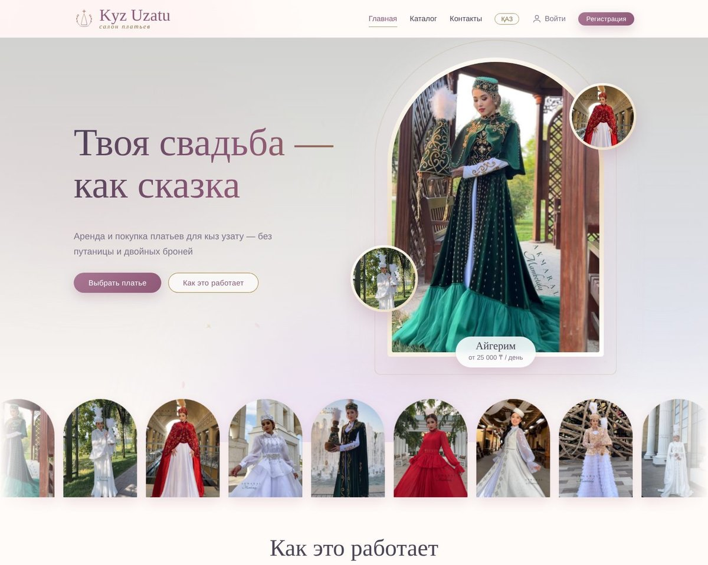
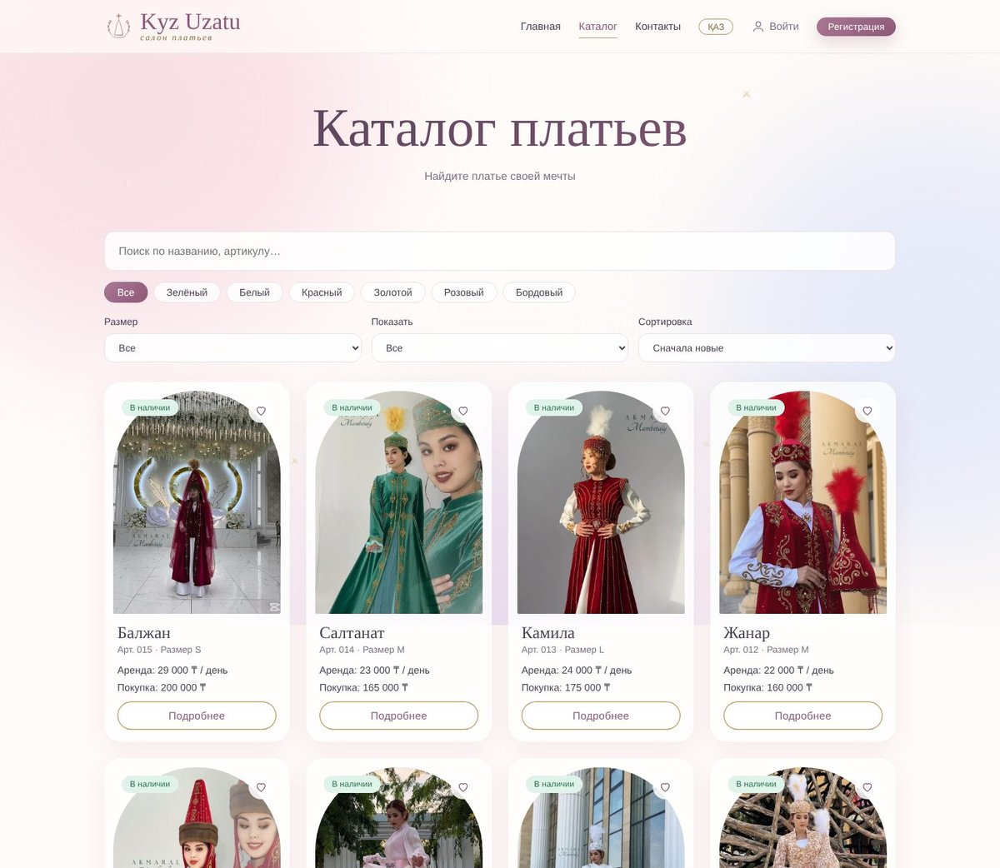
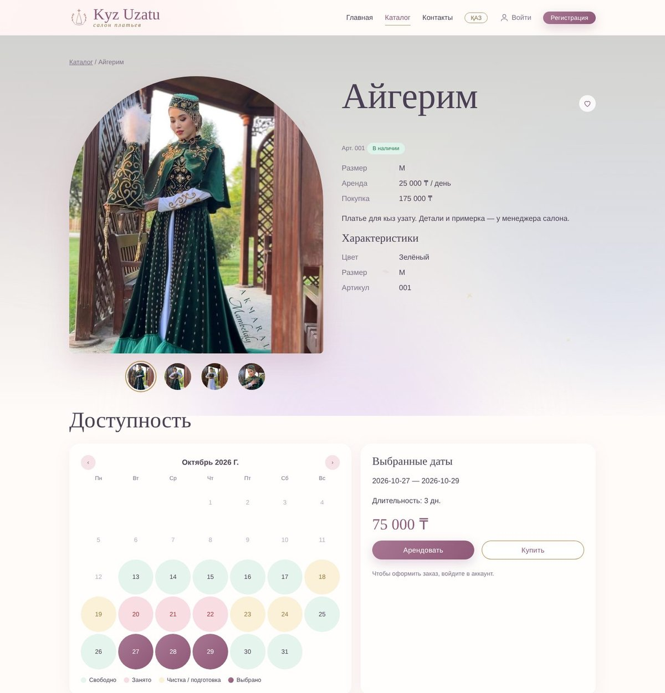
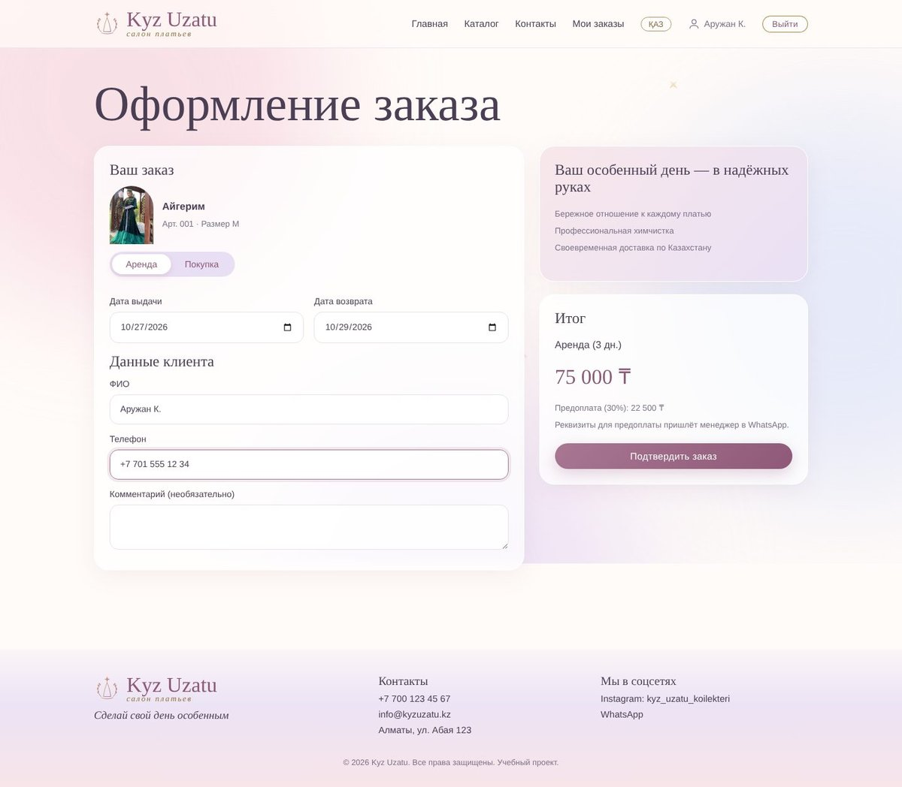
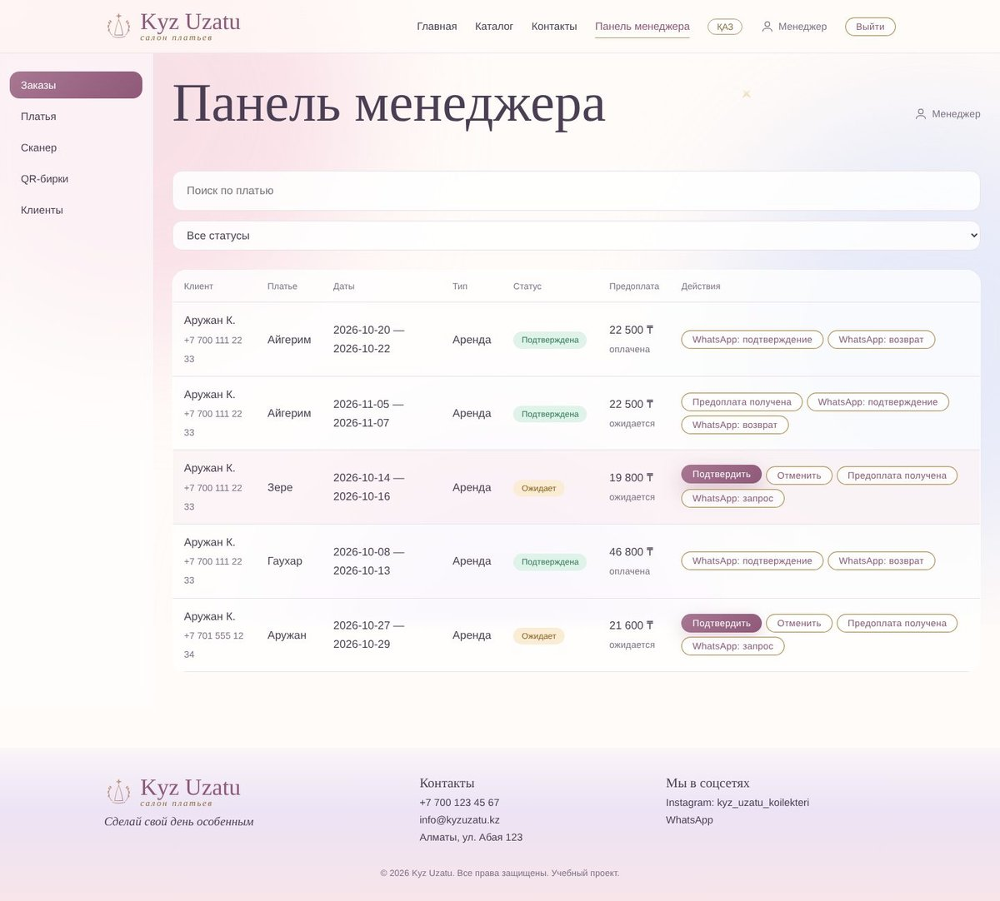
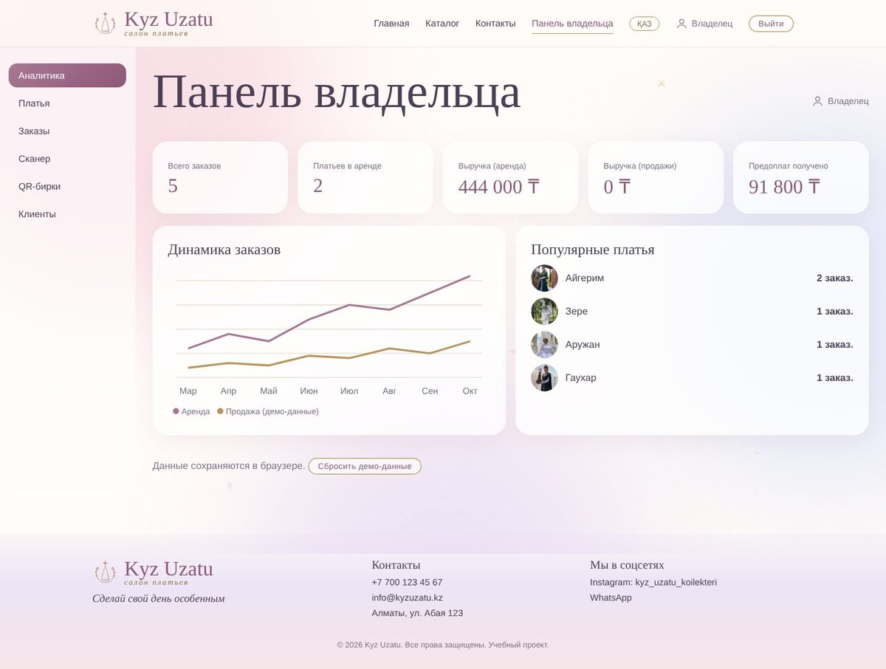
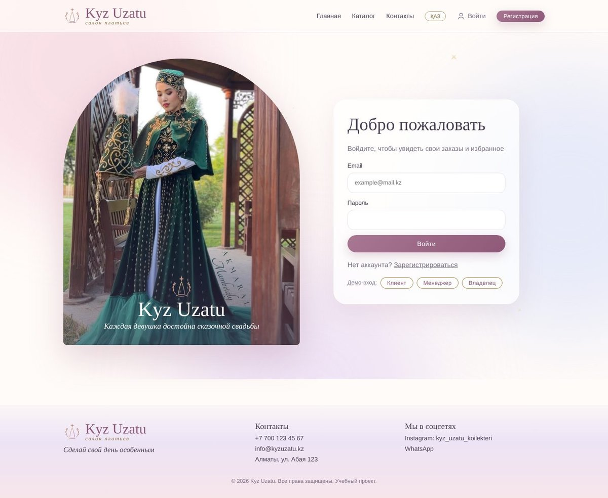

# Kyz Uzatu — цифровая система аренды и продажи платьев


Веб-приложение для салона платьев кыз узату: единый учёт аренды и продажи, проверка дат без двойных броней, статусы платьев от брони до возврата, QR-бирки для быстрой смены статуса.

> Учебный курсовой проект по дисциплине Full Stack (МУИТ / IITU). Текущая версия — frontend с mock-данными, без backend.

## Содержание
- [О проекте](#о-проекте)
- [Скриншоты](#скриншоты)
- [Возможности](#возможности)
- [Технологии](#технологии)
- [Быстрый старт](#быстрый-старт)
- [Мобильная версия](#мобильная-версия)
- [Демо-аккаунты](#демо-аккаунты)
- [Страницы и маршруты](#страницы-и-маршруты)
- [Как это работает](#как-это-работает)
- [Структура проекта](#структура-проекта)
- [Настройка](#настройка)
- [Публикация сайта](#публикация-сайта)
- [Планы развития](#планы-развития)
- [Команда](#команда)

## О проекте

**Проблема.** Небольшие салоны ведут учёт платьев в тетради, Excel и переписке Instagram/WhatsApp. Из-за этого одно платье обещают двум клиенткам на одну дату, а статус вещи (свободна, забронирована, в аренде, на чистке, продана) не всегда понятен.

**Решение.** У каждого платья своя карточка с фото, ценами аренды и продажи и статусом. Клиентка видит свободные даты и оформляет аренду или покупку онлайн. Система не даёт занять уже занятые даты, а сотрудники салона управляют заказами, статусами и каталогом.

Пример реализован для салона платьев для кыз узату (Instagram: `kyz_uzatu_koilekteri`).

## Скриншоты

| Главная | Каталог |
|---|---|
|  |  |

| Страница платья | Оформление заказа |
|---|---|
|  |  |

| Панель менеджера | Панель владельца |
|---|---|
|  |  |

| Вход | Мобильная версия |
|---|---|
|  |  |

## Возможности

**Клиент**
- каталог платьев: поиск, категории по цвету, фильтр по размеру и наличию, сортировка, избранное
- страница платья: несколько ракурсов, характеристики, календарь доступности
- оформление аренды или покупки с автоматической проверкой конфликта дат
- личный список заказов со статусом и предоплатой
- русский и казахский язык

**Менеджер**
- заказы: подтверждение и отмена, отметка о получении предоплаты, сообщения клиенту в WhatsApp с готовым текстом
- платья: смена статуса по цепочке, добавление, редактирование (данные, статус, фото) и удаление
- сканер QR и печать QR-бирок

**Владелец** — всё, что у менеджера, плюс аналитика: заказы, выручка от аренды и продаж, популярные платья.

## Технологии

| Область | Инструменты |
|---|---|
| UI | React 18, CSS (адаптивная вёрстка, анимации) |
| Маршрутизация | React Router 6 |
| Сборка | Vite 5 |
| QR | `qrcode.react` (создание), `html5-qrcode` (сканирование) |
| Состояние | React Context |
| Данные | mock-данные (`src/data.js`) + `localStorage` |
| Шрифты | Cormorant Garamond, Jost, Great Vibes |

## Быстрый старт

Требуется [Node.js](https://nodejs.org) версии 18 и выше.

```bash
git clone https://github.com/<username>/kyz-uzatu.git
cd kyz-uzatu
npm install
npm run dev
```

Откройте адрес из терминала (обычно http://localhost:5173).

Другие команды:

```bash
npm run build     # production-сборка в папку dist
npm run preview   # локальный просмотр сборки
```

## Мобильная версия

Сайт адаптивен (телефон, планшет, компьютер) и устанавливается на телефон как приложение (PWA): иконка на главном экране, запуск без адресной строки, быстрый доступ к сканеру QR для сотрудников. Таблицы в панелях на телефоне превращаются в карточки.

- **Посмотреть с телефона во время разработки:** запустите `npm run dev:host`, подключите телефон к той же Wi-Fi сети и откройте адрес вида `http://192.168.x.x:5173` из терминала. Камера по такому адресу не работает (нужен HTTPS).
- **Установка (Android, Chrome):** меню ⋮ → «Установить приложение». **iPhone (Safari):** «Поделиться» → «На экран Домой». Работает на опубликованном сайте.

## Демо-аккаунты

Пароль для всех: `1234`.

| Роль | Email | Доступ |
|---|---|---|
| Клиент | `client@kyz.kz` | каталог, заказы, мои заказы |
| Менеджер | `manager@kyz.kz` | панель менеджера |
| Владелец | `owner@kyz.kz` | панель владельца |

На странице входа есть кнопки быстрого демо-входа. Роль закреплена за аккаунтом, закрытые страницы недоступны другим ролям.

## Страницы и маршруты

| Маршрут | Страница | Доступ |
|---|---|---|
| `/` | Главная | все |
| `/catalog` | Каталог | все |
| `/catalog/:id` | Страница платья | все |
| `/login`, `/register` | Вход, регистрация | все |
| `/scan/:code` | Карточка платья по QR (статус меняют только сотрудники) | все |
| `/checkout/:id` | Оформление заказа | вошедшие |
| `/my-orders` | Мои заказы | вошедшие |
| `/manager` | Панель менеджера | менеджер, владелец |
| `/admin` | Панель владельца | владелец |

## Как это работает

**Проверка конфликта дат.** Диапазоны дат одного платья не должны пересекаться. Проверка учитывает дни на чистку до и после чужой аренды. Если даты заняты, сайт предлагает ближайшие свободные.

**Жизненный цикл платья.**

```
В наличии → Забронировано → В аренде / Продано → На чистке → В наличии
```

**Предоплата.** Для каждого заказа считается предоплата (по умолчанию 30%). Менеджер отмечает её получение.

**QR-коды.** У платья есть код `KU-<артикул>`, например `KU-001`. QR содержит ссылку `/scan/KU-001`. Сотрудник сканирует бирку, открывается карточка платья, и он меняет статус одной кнопкой. Клиент по той же ссылке видит только публичную карточку. Камера работает на HTTPS или `localhost`.

**Данные.** Состояние хранится в `localStorage` браузера. Кнопка «Сбросить демо-данные» в панели владельца возвращает исходные данные.

## Структура проекта

```
kyz-uzatu/
├── docs/screenshots/    скриншоты для README
├── public/
│   ├── img/             фото платьев (d1.jpg, d1.1.jpg — другие ракурсы)
│   ├── icons/           иконки приложения
│   ├── manifest.webmanifest, sw.js   установка на телефон (PWA)
│   └── _redirects       правило для Netlify
├── src/
│   ├── App.jsx          маршруты
│   ├── main.jsx         точка входа
│   ├── components.jsx   Navbar, Footer, ItemCard, Calendar, ProtectedRoute, ...
│   ├── pages.jsx        страницы и панели
│   ├── store.jsx        состояние, роли, проверка дат, заказы
│   ├── i18n.jsx         казахский перевод (словарь)
│   ├── data.js          mock-данные: платья, заказы, пользователи
│   └── index.css        стили
├── index.html
├── package.json
├── vercel.json          правило для Vercel
└── vite.config.js
```

## Настройка

- **Дни на чистку и предоплата:** константы `CLEAN` и `PREPAY` в `src/store.jsx`.
- **Новые платья:** через панель менеджера или владельца, либо в `src/data.js`.
- **Фото платьев:** файлы в `public/img`, пути в поле `photos` платья. Первое фото главное, остальные — другие ракурсы.
- **Перевод:** новые фразы добавляются в словарь `KK` в `src/i18n.jsx`.

## Публикация сайта

Подходят Vercel и Netlify: подключите репозиторий, команда сборки `npm run build`, папка публикации `dist`. Файлы `vercel.json` и `public/_redirects` уже настроены для маршрутов вроде `/scan/KU-001`.

Ссылка на опубликованный сайт: _добавьте после публикации_.

## Планы развития

- backend на Java (Spring Boot) и база данных PostgreSQL
- аутентификация по ролям (JWT)
- приём заказов из Instagram и WhatsApp
- онлайн-оплата предоплаты
- уведомления о дате возврата
- мобильное приложение или PWA для владельца

## Команда

| Участник | Роль |
|---|---|
| _Мамбеталі Аружан_ | Frontend |
| _Сагидуллаева Нуршат_ | Документация и GitHub |
| _Құнапия Нуркамал_ | UX/UI и графика |

---
Учебный проект, 2026. Фото платьев принадлежат салону.
